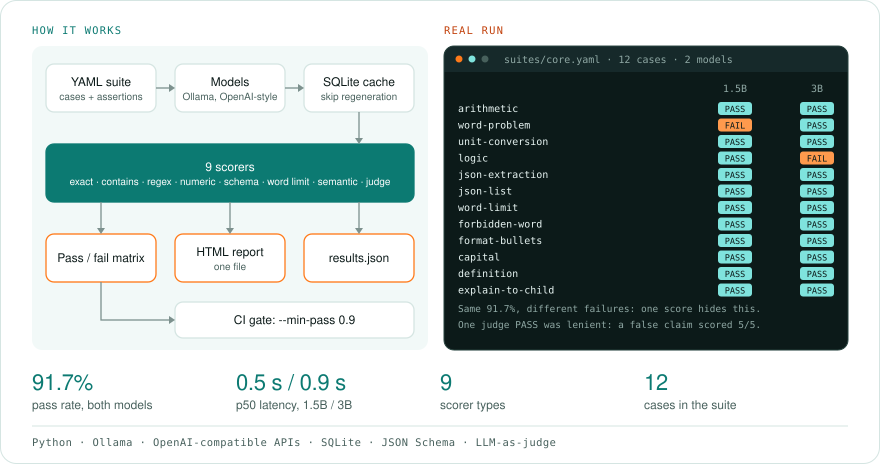

# prompt-tests

**pytest for prompts.** Write test cases for your LLM in YAML, run them against any number of local models, get a pass/fail matrix and a self-contained HTML report, and fail your CI build when quality drops. Swapping models, editing a system prompt or quantizing becomes a measured decision instead of a vibe check.

  

<!-- author-banner -->
> **Project 09 of 20** in my AI build series, designed and built by **[Abbishekk DGS](https://abbishekkdgs.tech)**. [See all projects →](https://github.com/Abbishekk-DGS)

```yaml
# suites/core.yaml
name: core-skills
system: You are a precise assistant. Follow the instructions exactly.
cases:
  - id: word-problem
    tags: [reasoning]
    input: A shop sells pens at 12 rupees each. Asha buys 7 and pays with a 100 rupee note. How much change?
    assert:
      - numeric: 16

  - id: json-extraction
    tags: [structured]
    input: 'Extract name, age, city as JSON. Text: "Meera, 29, moved to Coimbatore last year."'
    assert:
      - json_schema: {type: object, required: [name, age, city]}
      - contains: [Meera, Coimbatore]

  - id: explain-to-child
    input: Explain why the sky is blue to a 7-year-old in 3 sentences or fewer.
    assert:
      - llm_judge: Simple words, mentions light scattering, at most 3 sentences, factually correct.
```

```bash
prompt-tests run suites/core.yaml -m ollama:qwen2.5:1.5b -m ollama:qwen2.5:3b --judge ollama:qwen2.5:3b
```

<!-- overview:start -->
## Overview

<picture>
  <source media="(prefers-color-scheme: dark)" srcset="docs/overview-dark.svg">
  
</picture>

## Interface

You run it from the terminal and read the results in an HTML report.

```
prompt-tests run <suite.yaml> -m <model> [-m <model> ...] [options]
```

| Option | What it does | Default |
|---|---|---|
| `-m`, `--model` | `ollama:<model>` or `openai:<model>@<url>`; repeat to compare | required |
| `--judge` | Model for `llm_judge` assertions | |
| `--embed` | Ollama embedding model for `semantic` | `nomic-embed-text` |
| `--min-pass` | Exits with code 1 if a model's pass rate is below this | |
| `--workers` | Parallel workers | 2 |
| `--no-cache` | Skips the response cache | off |
| `--out` | Report folder | `prompt-tests-report` |

The report is one HTML file with a card per model (pass rate, mean score, p50 and p95 latency), pass rates by tag and a table of cases by model. Click any result to see the input, each model's output (the first sample if a suite repeats) and each scorer's score and reason. Each run also writes `results.json`.
<!-- overview:end -->

## Real run

The bundled 12-case suite, two local models, on an 8 GB Apple Silicon Mac:

| Model | Pass rate | Mean score | p50 latency | Failed |
|---|---|---|---|---|
| `qwen2.5:1.5b` | 91.7% | 0.91 | 0.5 s | *word-problem*: answered ₹70 change (correct: ₹16) |
| `qwen2.5:3b` | 91.7% | 0.91 | 0.9 s | *logic*: said "No" to a valid syllogism (all A are B, all B are C → all A are C) |

Same headline number, different weaknesses, which is exactly what a single score hides and a per-case matrix shows.

A lesson from the same run: the 3B judge gave **5/5** to an answer claiming "our eyes are more sensitive to blue light", which is false (human vision peaks in green). **Small models are lenient judges of their own family.** Use the strongest model you can run as `--judge`, and prefer deterministic scorers wherever the answer can be checked mechanically.

## Scorers

| Assertion | Passes when | Example |
|---|---|---|
| `exact` | normalized text equals value | `exact: Canberra` |
| `contains` / `not_contains` | every / none of the strings appear | `contains: [red, green, blue]` |
| `regex` | pattern matches | `regex: "^\\W*yes"` |
| `numeric` | the **last** number in the output is within `tolerance` | `numeric: 391` |
| `json_schema` | output (fences stripped) validates against a JSON Schema | `json_schema: {type: array}` |
| `max_words` | output length ≤ value | `max_words: 25` |
| `semantic` | embedding cosine similarity ≥ `threshold` | `semantic: "…reference…"`, `threshold: 0.8` |
| `llm_judge` | judge scores ≥ `threshold` (default 4/5) against a rubric | `llm_judge: "rubric…"` |

A case passes when **all** its assertions pass. Each scorer returns a 0–1 value and a human-readable reason, both shown in the report.

## Features

- **Multi-model comparison** in one run: any Ollama model, or any OpenAI-compatible server (`openai:model@http://localhost:8080/v1` for llama.cpp, vLLM, LM Studio)
- **Response cache** (SQLite): re-run with new scorers or rubrics without regenerating
- **`repeat: N`** with `temperature > 0` to measure consistency (a case shows `2/3` when it passes 2 of 3 samples)
- **Tags** with per-tag pass rates: reasoning vs structured output vs instructions
- **HTML report**: one file, no external assets, light/dark, click any cell for the full output and each scorer's reason
- **`results.json`** for your own analysis
- **CI gate**: `--min-pass 0.9` exits non-zero when any model drops below 90%

```yaml
# .github/workflows/prompts.yml (excerpt)
- run: uv run prompt-tests run suites/core.yaml -m ollama:qwen2.5:3b --min-pass 0.9
```

## Quickstart

```bash
ollama pull qwen2.5:3b && ollama pull nomic-embed-text    # https://ollama.com

git clone https://github.com/Abbishekk-DGS/prompt-tests && cd prompt-tests
uv sync
uv run prompt-tests run suites/core.yaml -m ollama:qwen2.5:3b --judge ollama:qwen2.5:3b
open prompt-tests-report/report.html
```

## Development

```bash
uv sync --extra dev && uv run pytest -q
```

Tests run offline with fake models: every scorer, schema validation, suite loading, model comparison, cache hits and report rendering.

## About the author

Built by **Abbishekk DGS**. More of my work at **[abbishekkdgs.tech](https://abbishekkdgs.tech)** and on **[GitHub](https://github.com/Abbishekk-DGS)**.

## License

MIT © Abbishekk DGS
